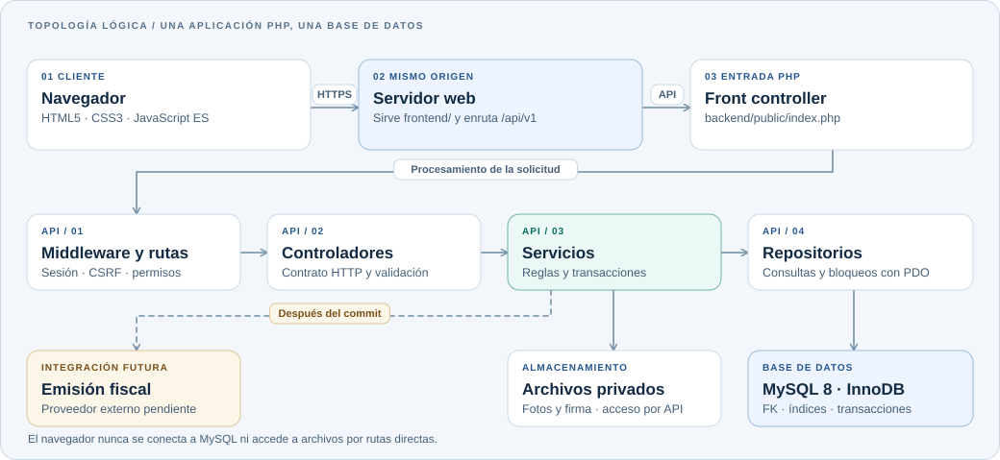

# Arquitectura del sistema

## 1. Resumen y alcance

**KRONOS TECH** es una aplicación interna para una tienda de informática que recibe equipos, realiza reparaciones y armados, vende productos y servicios, y administra caja. La recepción abre una orden; el taller registra diagnóstico y consumos; atención consulta presupuestos y saldos; caja cobra sobre la misma cuenta. No se vuelve a vender una reparación para poder cobrarla.

| Alcance de la V1 | Límite explícito |
|---|---|
| Acceso y roles, clientes y equipos, órdenes con borrador, recepción, evidencia y entrega, agenda y tablero operativo | Una empresa y una sucursal; varias ubicaciones de inventario y cajas identificadas en esa sucursal. |
| Catálogo, stock por ubicación, reservas parciales, movimientos, importación/exportación CSV y solicitudes internas de compra | Una solicitud no compra a proveedores ni aumenta existencias. No se contempla reposición automática. |
| Reparaciones y armados con presupuestos versionados, aprobaciones registradas y controles de compatibilidad | La aprobación registra conformidad obtenida por un canal real. No envía mensajes ni certifica compatibilidad sin evidencia. |
| POS, anticipos, cobros, anulaciones completas de POS, devoluciones de pagos de órdenes/proyectos, arqueos y auditoría | Pagos registrados, no procesados por el sistema. El POS no vende a crédito en V1. Las devoluciones parciales de ventas quedan fuera de esta propuesta inicial. |
| Comprobante de recepción, presupuesto y comprobantes internos imprimibles | No son documentos tributarios. Emisión fiscal, pasarelas, correo y WhatsApp requieren integraciones reales. |

**Decisión estructural:** un monolito modular en PHP y una base MySQL. Los módulos conservan fronteras de negocio, pero comparten transacciones locales. Por ejemplo, la venta, sus cobros y la salida de inventario se confirman juntos o no se registra ninguno. No se necesita un bus, un servicio separado para caja ni consistencia eventual para estas operaciones.

## 2. Diagrama de arquitectura



- **Navegador:** HTML5 semántico, CSS3 y módulos JavaScript ES. `fetch` consume `/api/v1`. No se mezclan vistas con PHP ni se ponen credenciales o reglas de autoridad en el cliente.
- **Entrada HTTP:** un servidor web en HTTPS publica `frontend/` y enruta `/api/v1/*` al único punto de entrada `backend/public/index.php` con PHP-FPM. El resto de `backend/`, `database/` y la configuración nunca se sirven como archivos estáticos. En local se mantiene el mismo origen.
- **Backend:** PHP 8.2 o superior, namespaces y autoload PSR-4 mediante Composer. Router, objetos de solicitud/respuesta y composición sencillos, sin framework. La API responde JSON salvo archivos privados y exportaciones documentadas.
- **Datos:** MySQL 8 con InnoDB, `utf8mb4`, claves foráneas y `CHECK` efectivamente aplicados (8.0.16+; preferir una rama 8.x con soporte). PDO usa parámetros preparados, excepciones y emulación de preparados desactivada. La cuenta de migración tiene DDL; la aplicación no.
- **Archivos privados:** fotos y firma de recepción fuera del directorio público. No se entregan URLs directas al almacenamiento; la API evalúa identidad, recurso y finalidad antes de servirlos.

### Capas y dirección de dependencias

| Capa | Responsabilidad | Límite |
|---|---|---|
| Frontend | Navegación, atención al usuario, estado de formularios y validaciones de ayuda. | No fija precios, no decide permisos ni genera saldos definitivos. |
| Router y middleware | Ruta/método, sesión, CSRF, límites, URL y permisos generales; identificación de solicitud. | No decide si una orden, pago o reserva puede cambiar de estado. |
| Controlador y validador | Validar forma, tipos y campos permitidos; mapear errores a HTTP; delegar al caso de uso. | No consulta PDO directamente ni administra transacciones. |
| Servicio de negocio | Autorizar sobre el recurso, validar invariantes, coordinar repositorios y transacciones. | Un caso de uso dueño de la transacción; otros servicios participan en ella sin confirmarla por su cuenta. |
| Repositorio / acceso a datos | Consultas preparadas, proyecciones y bloqueos explícitos; almacenar con la misma conexión del caso de uso. | No confía en parámetros para nombres de tabla/columna y no resuelve políticas de negocio. |
| Adaptadores | Sesión, cifrado, sistema de archivos, reloj, SQL y futura emisión fiscal. | Ninguna llamada externa dentro de una transacción comercial. |

**Dependencias funcionales.** Órdenes y armados consultan Catálogo e Inventario, y delegan cobros a Pagos. Ventas coordina Inventario + Pagos. Pagos exige un turno válido de Caja, pero Caja no vuelve a contabilizar el pago como un ingreso manual. Presupuestos registra la versión comercial y su aprobación, con destino en Orden o Armado. Dashboard lee proyecciones autorizadas; Auditoría recibe eventos de comandos sensibles en su propia transacción de negocio, no al margen de ella.

## 3. Estructura objetivo del repositorio

La estructura siguiente es de **implementación prevista**. Esta entrega crea únicamente documentación, no un proyecto ejecutable.

```text
kronos-tech/
├── frontend/
│   ├── index.html                     # Entrada; dirige según sesión
│   ├── pages/
│   │   ├── login.html
│   │   ├── dashboard.html
│   │   ├── ordenes.html
│   │   ├── nueva-orden.html
│   │   ├── detalle-orden.html
│   │   ├── clientes.html
│   │   ├── inventario.html
│   │   ├── armados.html
│   │   ├── ventas.html
│   │   ├── caja.html
│   │   └── administracion.html        # Usuarios, permisos, configuración y auditoría
│   └── assets/
│       ├── css/{tokens.css,base.css,layout.css,components.css,pages/}
│       ├── js/{config/,api/,components/,modules/,utils/}
│       └── images/
├── backend/
│   ├── public/index.php
│   ├── routes/api.php
│   ├── src/
│   │   ├── Controllers/               # Auth, Orders, Inventory, Sales, etc.
│   │   ├── Services/                  # Casos de uso agrupados por dominio
│   │   ├── Repositories/              # Consultas y persistencia PDO
│   │   ├── Models/                    # Estados, entidades y valores de dominio
│   │   ├── Middleware/
│   │   ├── Validators/
│   │   ├── Exceptions/
│   │   └── Support/                   # Conexión, transacciones, reloj, dinero, archivos
│   ├── config/
│   ├── storage/{logs/,uploads/,exports/}
│   ├── tests/{unit/,integration/,e2e/}
│   ├── composer.json
│   └── .env.example
├── database/{migrations/,seeders/,schema.sql}
├── docs/{arquitectura.md,modelo-datos.md,reglas-negocio.md,api.md,
│         plan-y-pruebas.md,instalacion.md,diagramas/}
├── .gitignore
└── README.md
```

`database/migrations/` será la fuente del esquema; `schema.sql`, una instantánea comprobable, no un segundo camino que se ejecute después de migrar. Los medios de prueba serán ficticios; el usuario administrador real se crea de manera controlada, sin contraseña fija en el repositorio.

## 4. Experiencia de uso y Figma

No se adjuntaron enlaces ni exportaciones de Figma. La arquitectura fija las responsabilidades de cada pantalla, pero no afirma haber revisado la referencia ni define en su nombre colores, grillas o puntos de quiebre definitivos. El enlace público de solo lectura o las exportaciones de escritorio y móvil permiten cerrar la correspondencia entre pantallas y componentes.

| Pantalla | Comportamiento de escritorio y móvil |
|---|---|
| Inicio y sesión | Login con etiquetas y error no revelador; navegación por rol; indicador de turno con aviso cuando no se pueda cobrar. Si vence sesión, proteger el borrador ya persistido y volver al recurso después de autenticar. |
| Dashboard | Indicadores con período y alcance, agenda editable, alertas y actividad. En móvil, orden de lectura lineal; sin indicadores de comparación inventados. |
| Órdenes y detalle | Filtros y paginación conservados en la URL, listado/CSV con el mismo alcance. En móvil, tarjetas con estado, equipo, prioridad y acción principal; el detalle separa recepción, taller, presupuesto y pagos según permiso. |
| Nueva orden | Etapas Cliente → Equipo y recepción → Servicio y presupuesto → Revisión y conformidad. Guardado explícito y recuperación del borrador; se conserva un solo paso activo en móvil. Cualquier cobro ocurre únicamente al confirmar. |
| Clientes e inventario | Buscador reutilizable. Aviso de duplicados antes del alta; productos con físico/reservado/disponible, historial y previsualización de importación. |
| Armados | Componentes y mano de obra, avisos de compatibilidad con causa, cotización imprimible y avances. Los costos internos no se incluyen en el documento al cliente. |
| Ventas y caja | Carrito y totales visibles, medios separados y cambio en efectivo; confirmación única. En móvil, búsqueda y resumen accesibles sin depender de un ancho de escritorio. Arqueo conserva esperado, contado y diferencia. |

Componentes: navegación, cabecera de turno, filtros, badges con texto, diálogo de confirmación, paginación, campos y mensajes, resumen monetario, tabla/tarjeta y hoja imprimible. Los tokens CSS se ajustan al revisar Figma. Requisitos comunes: navegación por teclado, foco visible y restaurado al cerrar diálogos, etiquetas persistentes, errores asociados a cada campo, anuncios de estado, contraste y no depender del color. Mostrar carga, vacío, error y éxito; no devolver una lista vacía en lugar de un error. Sin botones que prometan operaciones externas inexistentes.

## 5. Matriz de roles y permisos

Los códigos se asignan vía `role_permissions` y `user_roles`. El servidor combina permisos efectivos y, por separado, alcance y proyección de campos. **Propio** significa borrador creado por el usuario o turno vigente del que es responsable; **asignado** se deriva del técnico del recurso, no de un ID enviado por el navegador. Un administrador puede intervenir un turno ajeno con un permiso distinto, referencia explícita a ese turno y motivo auditado.

| Permisos | Administrador | Recepción / ventas | Técnico |
|---|---|---|---|
| `dashboard.read`, `agenda.read`, `agenda.write` | Global | Operación de la sucursal | Lectura de agenda/indicadores asignados, sin totales financieros |
| `customers.read/write`, `devices.read/write` | Sí | Sí | Datos mínimos solo desde la orden asignada, sin listado general ni cambios |
| `orders.read`, `orders.export` | Sí | Sí | Lectura asignada, sin exportación ni campos financieros |
| `orders.receive`, `orders.assign`, `orders.deliver` | Sí | Sí; asignar técnicos habilitados y confirmar entrega | No |
| `orders.tech`, `orders.cancel` | Ambos | No | `orders.tech` asignado: diagnóstico, tareas, pruebas y avances; no cancelar |
| `orders.access.write`, `orders.access.reveal` | Ambos | Solo escribir o retirar, no revelar | Revelar únicamente en su orden asignada, con reautenticación y motivo |
| `catalog.read`, `stock.read` | Sí | Sí; precio comercial | Solo proyección de datos técnicos y disponibilidad, sin costos ni precios internos |
| `catalog.manage`, `costs.read`, `stock.adjust`, `stock.import` | Sí | No | No |
| `stock.reserve`, `stock.consume`, `purchase.request`, `purchase.manage` | Sí | Solicitar compra | Reservar/liberar/consumir en sus órdenes o armados; solicitar compra |
| `projects.read`, `projects.manage`, `projects.tech`, `projects.deliver`, `projects.cancel` | Sí | Lectura, gestión comercial y entrega | Lectura asignada y trabajo técnico (incluidas propuestas de componentes en borrador), sin costos |
| `quotes.read`, `quotes.manage`, `quotes.approve` | Sí | Edición comercial y registro de decisión del cliente; sin costos ni autorización de descuentos propia | Solo estado de cotización desde el recurso asignado |
| `sales.read`, `sales.create`, `pricing.discount`, `sales.void` | Sí | Consulta y confirmación; no autoriza descuentos ni anula | No |
| `payments.post`, `payments.refund` | Ambos | Cobrar en turno propio | No |
| `cash.read`, `cash.operate`, `cash.override` | Todos | Leer y operar su turno (apertura, arqueo, movimientos permitidos y cierre) | No |
| `audit.read`, `reports.read`, `users.manage`, `settings.manage` | Sí | No | No |

Los permisos agrupados como `customers.read/write` representan `customers.read` y `customers.write`. Una técnica o un técnico no ve el saldo general del cliente aunque conozca su ID. Si una persona tiene múltiples roles, el acceso adicional es explícito y auditable. Filtros, detalle, CSV y archivos aplican el mismo alcance. Cambios de roles, asignaciones y desactivaciones tienen efecto en la siguiente solicitud; no se confía en roles guardados en el frontend.

## 6. Seguridad y operación

- **Identidad:** `password_hash()` / `password_verify()`, `password_needs_rehash()` cuando corresponda. Login por usuario o correo normalizados; mensaje genérico ante credenciales inválidas y límite de intentos por identificador e IP. No confiar en cabeceras de proxy salvo de proxies conocidos. Bloquear cuentas desactivadas y preservar al menos un administrador habilitado.
- **Sesión y CSRF:** sesión opaca de servidor, ID regenerado en login y sesión invalidada en logout. Propuesta inicial: 30 minutos de inactividad y 8 horas absolutas, independientes del turno. Cookie host-only, `HttpOnly`, `SameSite=Lax`, `Secure` en HTTPS y modo estricto de PHP. Token sincronizado también para login y validado en toda operación mutante. El cliente no guarda secretos ni IDs de sesión en `localStorage`. Liberar el bloqueo de la sesión PHP antes de ejecutar transacciones de negocio, para que las condiciones de concurrencia queden protegidas por MySQL, no por la sesión HTTP.
- **Superficie HTTP:** mismo origen, HTTPS, sin CORS abierto. Si se separan orígenes, preferir un reverse proxy; si no es posible, habilitar lista explícita, preflight controlado, `credentials` solo para el origen aprobado, `Vary: Origin` y conservar CSRF. Cualquier cambio en `SameSite` debe revisarse según si el despliegue es también cross-site. Validación con allowlists, escape según contexto y uso de `textContent` para datos de usuarios. Encabezados CSP y `nosniff`; las respuestas privadas no se almacenan en cachés compartidas.
- **Contraseña temporal del equipo:** opcional, aislada y cifrada por AEAD con `libsodium`, clave versionada fuera de MySQL, nonce aleatorio y datos asociados a la orden. Proponer 7 días de vigencia como máximo inicial; vencimiento o entrega/cancelación inutilizan el acceso. Nunca incluir en JSON de listados, HTML imprimible, logs, borradores persistidos ni auditoría. Revelación con reautenticación reciente, permiso específico, motivo y respuesta `no-store`; el evento registra el acceso, no el secreto. La política de copias y rotación debe explicar cuándo desaparecen las copias antiguas.
- **Fotografías y firma:** permitir inicialmente JPEG, PNG y WebP para fotos; validar tamaño, extensión, MIME real, decodificación y dimensiones; rechazar SVG/HTML y quitar metadatos innecesarios al recodificar. Usar identificador y ruta generados, sin aceptar rutas del cliente, y servir solo mediante API autorizada. Preparar archivo privado antes de publicar metadatos y limpiar temporales/huérfanos ante fallos. La firma de recepción acredita un registro interno; no se presenta como firma electrónica certificada.
- **Auditoría y recuperación:** registrar actor, momento UTC, acción, entidad, alcance y cambios permitidos; no guardar contraseñas, tokens, RUT completos, dumps de solicitudes o archivos. Logs operativos estructurados con identificador de solicitud y errores internos restringidos. Backups cifrados de MySQL y archivos privados con prueba de restauración y plan separado para las llaves; conservación y eliminación de datos a confirmar antes de producción.

## 7. Decisiones por confirmar

| Decisión | Propuesta de esta arquitectura | Momento de confirmación |
|---|---|---|
| Figma y flujo visual | Revisar frames y recorridos reales de escritorio y móvil; aplicar sus tokens sobre los módulos aquí definidos. | Antes de cerrar UI y aceptación visual. No bloquea la arquitectura ni el diseño de datos. |
| Caja y condiciones comerciales | Una sucursal y varias cajas; un turno abierto por caja y por responsable. Exigir turno incluso para débito/transferencia; sin entrega con saldo pendiente en V1. | Antes de fijar datos y flujos de cobro. Confirmar si hay cajas compartidas, crédito o entregas con deuda. |
| Política tributaria y descuentos | CLP sin decimales operativos, precios con IVA del 19 % incluido por defecto; descuentos globales autorizados y prorrateados. POS anula ventas completas. | Validar tratamiento de exentos, redondeo y devolución parcial si se necesita. Definir proveedor y requisitos fiscales por separado. |
| Conformidad y conservación | Confirmación registrada con versión de política, firma según tipo de recepción, anticipo limitado por estimación aceptada, credencial temporal con caducidad. | Antes de recibir datos reales: texto de autorizaciones, plazos de fotos/firmas/auditoría y reglas de reembolso. |
| Despliegue y escala | Un servicio PHP y MySQL como primera topología; backups y restauración comprobables. | Antes de producción: hosting, volumen, uso simultáneo, traspaso de datos y objetivos de recuperación. |

Para el detalle de entidades y claves, ver [Modelo de datos](modelo-datos.md). Los flujos monetarios y de concurrencia están en [Reglas de negocio](reglas-negocio.md); los contratos y criterios de entrega, en [API REST](api.md) y [Plan y pruebas](plan-y-pruebas.md).
