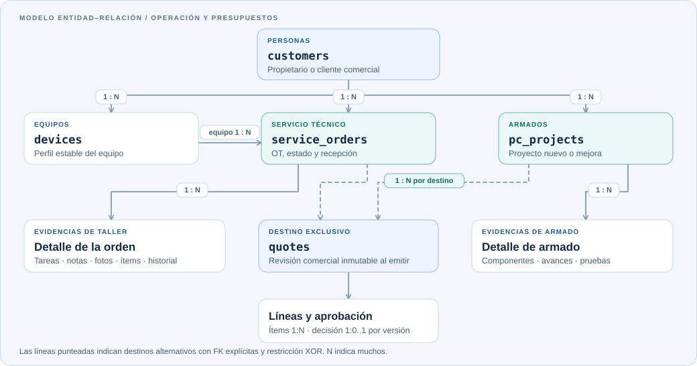
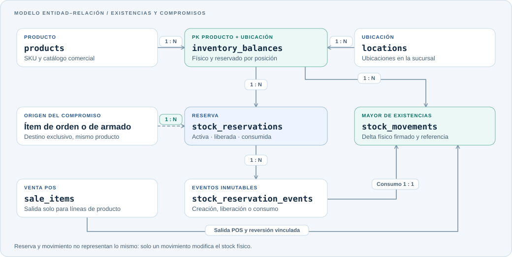
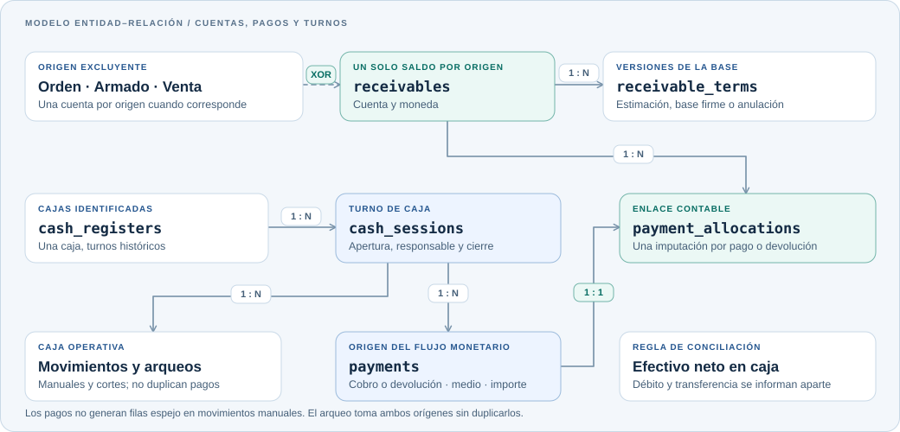

# Modelo de datos

## 1. Convenciones

- **Motor y texto:** InnoDB y `utf8mb4`. Colación insensible a mayúsculas/acentos para búsquedas humanas; claves de negocio normalizadas con comparación determinista. PK `BIGINT UNSIGNED` salvo tablas puente y claves naturales expresas. Los identificadores se serializan como cadenas en JSON para no perder precisión en JavaScript.
- **Estado y fechas:** códigos de estado controlados con `CHECK` y validación de transiciones en servicios. Timestamps `DATETIME(6)` en UTC; API en RFC 3339. Fechas civiles y períodos operativos en `America/Santiago` inicialmente. Las FK de documentos y movimientos usan `RESTRICT`; no se borran documentos confirmados. Las tablas puente de acceso pueden retirar una relación con auditoría.
- **Importes:** `DECIMAL(18,4)` en catálogo, documentos y mayor de pagos. Moneda ISO y escala operativa se guardan en las cabeceras monetarias; CLP inicia a escala 0. Los unitarios, cantidades, tasas, descuentos, totales y costos cuando corresponda quedan congelados en los detalles confirmados. `tax_bps` entero; `1900` representa 19 %. Cantidades físicas enteras; `delta` de inventario es entero con signo.
- **Versiones:** cabeceras editables con `version` incremental; hechos confirmados por adición de eventos o contramovimientos. Números de recepción, proyecto y venta mediante prefijo estable e ID autoincremental (`OT-…`, `PC-…`, `VTA-…`); la OT solo se muestra numerada tras confirmar. Sin `MAX(id)+1`; se admiten huecos. El proveedor fiscal, si llega, asigna su propia numeración.
- **Relaciones polimórficas:** `quotes`, `receivables`, `stock_reservations` y auditoría usan FK explícitas y restricciones de exclusión, no un par libre `tipo/id`. Los servicios verifican además pertenencia, tipo permitido y restricciones entre filas bajo bloqueo. Las tablas siguientes son de diseño, no DDL ejecutado.

## 2. Personas, servicio y presupuestos

| Tabla | Campos y propósito principales | Restricciones e índices relevantes |
|---|---|---|
| `users` | `username_norm`, `email_norm`, `password_hash`, `display_name`, `is_active`, `kind`, fechas | Usuario y correo únicos. Identidad `system` sin login para procesos internos. Datos de sesión fuera de listados. |
| `roles`, `permissions` | Catálogos de acceso con `code` estable | `UNIQUE(code)` por tabla. |
| `role_permissions`, `user_roles` | Mapeo de permisos a roles y roles a usuarios | PK compuesta en cada puente; índice inverso para revocación y consultas. |
| `customers` | Nombre, documento original y normalizado, tipo/emisor, teléfono normalizado, correo, dirección/comuna, notas, fechas | Documento opcional, trío completo si se declara. `UNIQUE(document_type, document_issuer, document_norm)`. Índices en nombre, teléfono y correo para búsqueda y alertas; teléfono/correo repetidos no bloquean por sí solos. |
| `devices` | `customer_id`, tipo, marca, modelo, serie, SO, notas | FK a cliente y clave candidata `(id, customer_id)`. Índices `(customer_id,id)` y `serial_norm`; serie opcional, aviso de repetición, no unicidad global. |
| `service_orders` | Cliente, equipo, técnico, creador, estado/prioridad, falla, diagnóstico, condición visual al ingreso, fechas estimada/real, versión, formulario parcial permitido | FK `(device_id,customer_id)` evita asociar equipo ajeno; cliente/equipo obligatorios al confirmar y propietario no transferible en V1. Índices de estado/fecha, técnico/estado/fecha, cliente/fecha y entrega estimada. Borradores solo por creador o admin. |
| `service_order_status_history` | Orden, estado anterior/nuevo, actor, motivo y fecha | FK orden/actor; índice `(order_id,id)`. Primer evento de confirmación deja la entrada a `recibido`. |
| `service_order_tasks`, `service_order_notes` | Tareas con responsable, estado, progreso y resultados; notas internas separadas con autor/fecha | FK a orden/usuario, índices orden/fecha. Progreso entero 0–100, tareas editables con versión, notas aditivas. |
| `service_order_accessories` | Orden, tipo/nombre, cantidad, condición; evidencia de ingreso | FK a orden, cantidad positiva. Copia de ingreso preservada en el comprobante; no se mezcla con el perfil del equipo. |
| `private_files`, `service_order_photos` | Archivo privado con orden propietaria, clase, ruta opaca, MIME, tamaño y fechas; fotos con fase, autor y observación | URI privada generada única. FK compuesta `(file_id,order_id)` desde foto; clase de archivo validada. Índice orden/fase. |
| `service_order_consents` | Orden, tipo de autorización/verificación, decisión, `policy_version_id` cuando aplique, responsable, momento, firma privada opcional | FK a orden, política y archivo de la misma orden. Firma solo de clase admitida. No se reescribe una aceptación registrada. |
| `service_order_receipts` | Una instantánea inmutable por OT con datos mínimos de recepción, accesorios, falla, condición y consentimientos referenciados | PK/FK `order_id`. Permite reimprimir lo recibido aunque el cliente o el diagnóstico se editen después. No contiene secreto ni datos internos de taller. |
| `service_order_secrets` | Credencial opcional de acceso: `order_id`, cifrado, nonce, `key_version`, expiración | PK/FK `order_id`; índice de expiración. Solo repositorio especializado; se elimina la fila al dejar de ser necesaria. |
| `service_order_items` | Servicio/repuesto propuesto, descripción, cantidad, estimación y versión | FK a orden y XOR de `product_id` / `service_id`; clave candidata `(id,product_id)` para reserva de repuesto real. No crea cobro por existir. |
| `pc_projects` | Cliente, técnico, tipo nuevo/mejora, equipo base cuando corresponde, uso, estado, versión, fechas y `archived_at` | FK equipo/cliente; índices por estado/fecha, cliente y técnico. El archivo no borra el historial. |
| `pc_project_items`, `pc_project_updates` | Componentes/mano de obra; avances, resultados de pruebas y eventos de estado | FK a proyecto; XOR producto/servicio y clave `(id,product_id)` en ítems. Avances aditivos, actor/fecha. |
| `quotes` | `service_order_id` o `pc_project_id`, revisión, estado, validez, huella del alcance técnico/comercial, moneda/escala, totales y política tributaria | Exactamente un destino por `CHECK` + FK. `UNIQUE(service_order_id, revision)` y `UNIQUE(pc_project_id, revision)`, revisión asignada bajo bloqueo del padre. Índice estado/vencimiento. |
| `quote_items`, `quote_approvals` | Líneas congeladas tras emisión; eventos de aprobación/rechazo con procedencia, actor y fecha | Ítems FK a presupuesto y XOR producto/servicio, con instantáneas y orden de línea. Una decisión terminal por revisión en V1 (`UNIQUE(quote_id)` en aprobaciones), previa transición válida. |

`policy_versions` identifica la versión del texto de consentimiento (tipo, versión, vigencia, texto o huella), de modo que un cambio de política no cambie retroactivamente una recepción. Una credencial de equipo nunca se guarda en `devices`, notas, `service_order_receipts` ni payloads de borrador; el almacenamiento parcial es una lista explícita de campos de recepción no secretos.

## 3. Catálogo e inventario

| Tabla | Campos y propósito principales | Restricciones e índices relevantes |
|---|---|---|
| `categories`, `suppliers`, `locations` | Referencias de categoría, proveedor y ubicación física | Identificador interno y código/slugs únicos. Inactivación sin eliminar referencias; una ubicación inactiva exige vaciar stock y reservas antes de deshabilitarse. |
| `products` | SKU, nombre/descripción, categoría, proveedor principal, ubicación sugerida, costo, precio de lista, impuesto, mínimo, activo | `UNIQUE(sku_norm)`, FK a los tres catálogos; importes/mínimo no negativos; índices por categoría/estado/nombre. No almacena una cantidad editable en catálogo. |
| `service_catalog` | Código, servicio, costo, precio de lista, impuesto, activo | Código único, validaciones de importes y estados. No genera movimiento de stock. |
| `inventory_balances` | `product_id`, `location_id`, `on_hand`, `reserved`, fecha | PK `(product_id,location_id)`. FK a producto/ubicación; `CHECK(0 <= reserved AND reserved <= on_hand)`. Posición bloqueable; disponible derivado, no campo editable. |
| `stock_reservations` | Producto, ubicación, ítem objetivo, cantidad inicial/activa/liberada/consumida | XOR `service_order_item_id` / `pc_project_item_id`; FK compuesta que confirma el mismo producto que el ítem, y FK a posición. `initial_qty = active_qty + released_qty + consumed_qty`; índices por ítem y posición activa. |
| `stock_reservation_events` | Reserva, creación/liberación/consumo, cantidad positiva, actor, motivo, fecha | FK a reserva, índice reserva/ID; inmutable. Expirar es liberar con motivo. |
| `stock_movements` | Posición, tipo, `delta`, motivo, autor, fecha, referencias específicas al origen | FK a posición; índice `(product_id,location_id,occurred_at,id)`. Salida POS se vincula al `sale_item_id`; consumo a `reservation_event_id` único. Devolución de taller usa `returned_from_id`; contramovimiento total usa `reversal_of_id` único, ambos FK al movimiento original y misma posición. Reglas por tipo impiden orígenes contradictorios. |
| `purchase_requests`, `purchase_request_items` | Solicitud, estado, actor y líneas de producto/cantidad | FK; `UNIQUE(request_id,product_id)` en ítems. No son un movimiento ni una orden al proveedor. |
| `product_technical_specs` | Una ficha por producto: rol de componente, socket, memoria, ranuras/capacidad, formatos, medidas en mm, potencia en W, fuente y fecha de evidencia | PK/FK `product_id`; atributos tipados dependientes del rol y `NULL` para desconocido. Formatos aceptados por gabinete en `product_case_formats`; cantidades de conectores por tipo/lado en `product_spec_connectors`. |
| `product_bios_support` | Placa + revisión, CPU, versión mínima o conjunto de versiones compatibles, fuente verificable y fecha | FK a ambos productos; unicidad por placa/revisión/CPU. La lógica valida rol y ordenamiento de versiones según evidencia documentada, no por comparación de texto genérica. |

El movimiento de venta debe coincidir con el producto, ubicación y cantidad del ítem (FK compuesta de producto/ubicación y validación de delta en la transacción). El consumo coincide con el evento y con la posición de su reserva. Índices en referencias de origen permiten reconciliar sin escanear el historial. Cantidades parciales de devolución no pueden superar la salida neta original; la V1 no expone devolución parcial de POS desde inventario.

## 4. Ventas, cobros y caja

| Tabla | Campos y propósito principales | Restricciones e índices relevantes |
|---|---|---|
| `sales`, `sale_items` | Venta confirmada/anulada, turno de venta, actor, cliente opcional, moneda, totales y fechas. Detalles con producto/servicio, cantidad, unitario, costo interno, impuesto, descuento y total histórico. | FK cliente/turno/actor. Ítems XOR producto/servicio; posición obligatoria para producto, ninguna para servicio. Índices venta por fecha/estado/cliente y de ítems por venta; clave candidata del ítem con producto y ubicación. |
| `receivables` | Cuenta para un único `service_order_id`, `pc_project_id` o `sale_id`; moneda y escala | Tres FK explícitas, XOR, `UNIQUE` por origen y candidato `(id,currency_code,currency_scale)`. La cuenta no guarda un «pagado» editable. |
| `receivable_terms` | Historial de base de cobro: versión, `estimate` / `firm` / `void`, importe, presupuesto opcional y actor/motivo | `UNIQUE(receivable_id,version)`, FK a cuenta y a presupuesto si aplica. Revisiones consecutivas bajo bloqueo de cuenta. La aplicación verifica que la cotización pertenezca al mismo origen y conserve la moneda y su escala. |
| `payments` | `cash_session_id`, actor, método, `capture` o `refund`, importe positivo, fecha, referencia no sensible; recibido/cambio para efectivo y `refund_of_id` para devoluciones | FK a turno con moneda/escala y auto-FK a pago original. Índices `(cash_session_id,method,occurred_at,id)`, `refund_of_id`. Devoluciones validan mismo método, cuenta y moneda, con tope acumulado. |
| `payment_allocations` | Imputación completa de cada pago (o devolución) a una cuenta en V1 | PK `payment_id` para impedir doble imputación; FK compuestas desde pago y cuenta con misma moneda/escala. Índice `(receivable_id,payment_id)`; el importe viene de `payments`, no se duplica. |
| `cash_registers` | Código, nombre, estado y referencia operativa de la caja | `UNIQUE(code)`. Una caja con turno activo no se deshabilita. |
| `cash_sessions` | Caja, moneda/escala, responsable, actor de apertura/cierre, saldo inicial, fechas, estado | FK a caja/usuarios. Columnas generadas anulables `open_register_id` y `open_operator_id`, únicas solo cuando `closed_at IS NULL` (varios `NULL` permitidos); índice de historial por caja y fecha. |
| `cash_movements` | Solo ingresos/retiros manuales; turno, importe positivo, dirección, motivo, autor y fecha | FK turno/actor, índice turno/fecha. Sin filas espejo de pagos ni de apertura. |
| `cash_counts` | Arqueo parcial o final; totales por método separados, esperado, contado, diferencia, observaciones, actor y corte UTC | FK a turno/actor. Clave generada única para el arqueo final por turno; permitir varios parciales. Corte y cambio de estado final se guardan en la misma transacción. |

`receivable_terms` determina la base vigente por última versión y `payments` con su imputación determinan el pagado neto. Un presupuesto histórico no añade otra deuda. Una venta confirmada tiene una cuenta firme y una o más imputaciones que la liquidan exactamente. Una orden confirmada puede no tener base firme todavía. Los cobros se reflejan en caja por la relación al turno, no por copias contables.

## 5. Operación, trazabilidad y soporte

| Tabla | Campos y propósito principales | Restricciones e índices relevantes |
|---|---|---|
| `appointments` | Cliente, orden opcional, responsable, tipo recepción/entrega/llamada, inicio, estado y notas | FK cliente y FK `(service_order_id,customer_id)` candidata de órdenes. Índices `(scheduled_at,status,id)` y `(assigned_user_id,scheduled_at)`. |
| `audit_logs` | Actor, acción, fecha UTC, identificador de solicitud, cambios seleccionados, objetivo | FK a actor; columnas objetivo tipadas (`order_id`, `project_id`, `quote_id`, `sale_id`, `payment_id`, `reservation_id`, `movement_id`, `cash_session_id`, `subject_user_id`, `role_id`, `product_id`, `customer_id`, `device_id`, `appointment_id`, `purchase_request_id`, `setting_id`), exactamente una por `CHECK`. Eventos hijos apuntan a la raíz del caso cuando basta (p. ej. acceso temporal → orden); validación de acción/objetivo en el emisor. Índices actor/fecha, acción/fecha y destino/fecha para consultas principales. |
| `settings` | Parámetros tipados y con allowlist: zona, moneda y escala inicial, IVA, reglas operativas y referencias a políticas | Clave única. Variables secretas no pertenecen a esta tabla. Cambios de política congelados por versión en documentos nuevos. |
| `idempotency_keys` | Actor, comando, clave, huella de la solicitud, respuesta mínima, código HTTP y fecha | `UNIQUE(actor_id, command, client_key)`; nunca guarda contraseñas ni cuerpos crudos. Huella de solicitud con HMAC. Los datos de replay no son referencias contables. |
| `csv_import_batches`, `auth_attempt_limits`, `schema_migrations` | Lote temporal/resultado de validación; contadores de acceso con expiración; historial de migraciones y checksum | Vencimiento/propiedad del lote; claves de limitación no contienen usuario/correo crudo; versión única en migraciones. |

**Consultas y consistencia.** Ordenar listas por fecha o nombre más ID como desempate; combinar índices con el filtro de alcance por rol. SKU, números de documento y teléfonos usan búsquedas normalizadas, y las búsquedas por persona/equipo ofrecen prefijos de campos o tokens (índice de texto si el volumen lo justifica). Rangos de fecha se calculan como límites UTC y se pasan a SQL para preservar los índices. Reconciliar posiciones contra el mayor de movimientos y reservas activas; conciliar pagos → imputaciones → turno antes de declarar un corte válido. Las correcciones no borran historia.

Ver [Reglas de negocio](reglas-negocio.md) para el orden de bloqueos, redondeos y transiciones. Los diagramas muestran relaciones principales; las restricciones completas se especifican en el diccionario.
